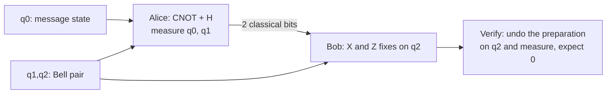
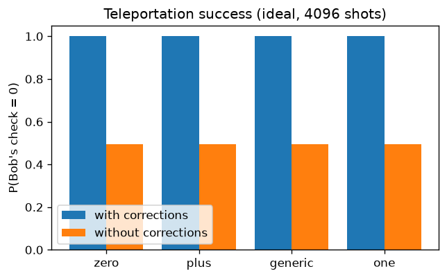
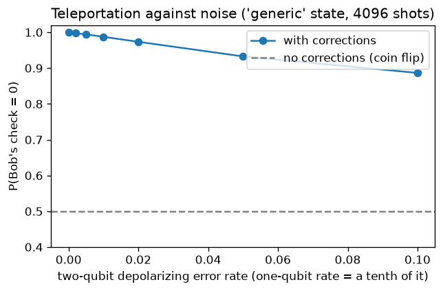

# 02 · Qiskit quantum teleportation


Teleports the state of one qubit from Alice to Bob using a shared entangled pair and two classical bits, built in [Qiskit](https://www.ibm.com/quantum/qiskit). The circuit is checked two ways: an exact statevector test, and a simulated run with mid-circuit measurements and classically controlled corrections. A negative control (skip the corrections) shows the corrections are what make it work.

> **Disclaimer:** everything here runs on a simulator. The noise model uses illustrative error rates, not values calibrated to any real IBM device. Nothing in this repo has been run on quantum hardware yet. Teleportation moves a quantum state, not matter or energy, and it needs the classical bits, so it cannot send information faster than light.

## Contents

- [Results at a glance](#results-at-a-glance)
- [Quick start](#quick-start)
- [How it works](#how-it-works)
- [Repository layout](#repository-layout)
- [Limitations](#limitations)
- [Next steps](#next-steps)



## Results at a glance

Probability that Bob's verification bit is 0 (1.0 = state arrived intact), 4096 shots, seed 42:

| Message state | Ideal, with fixes | Noisy, with fixes | Ideal, no fixes |
|---|---|---|---|
| `zero` (θ=0) | 1.000 | 0.989 | 0.496 |
| `plus` (θ=π/2) | 1.000 | 0.988 | 0.494 |
| `generic` (θ=1.1, φ=2.3) | 1.000 | 0.987 | 0.494 |
| `one` (θ=π) | 1.000 | 0.989 | 0.494 |

Without the fixes Bob's qubit is, averaged over Alice's four random outcomes, maximally mixed, so the check is a coin flip (about 0.5). The statevector test also confirms a fidelity of 1.0 for the deferred-measurement version.



### How much noise can it take?

Sweeping the two-qubit depolarizing error rate (the one-qubit rate is a tenth of it) for the `generic` state, with corrections:

| Two-qubit error | 0 | 0.002 | 0.005 | 0.01 | 0.02 | 0.05 | 0.1 |
|---|---|---|---|---|---|---|---|
| Success | 1.000 | 0.997 | 0.994 | 0.987 | 0.973 | 0.933 | 0.886 |



Success falls smoothly, roughly linearly in the error rate, and stays well above the 0.5 coin flip of the no-corrections control even at 10% two-qubit error. The circuit uses only two CNOTs in total, so there are few places for a two-qubit error to enter. The 0.01 column is the same noise level as the noisy table above.

## Quick start

```powershell
git clone https://github.com/Madmaxcoder2612/qiskit-teleportation
cd qiskit-teleportation
python -m venv .venv
.\.venv\Scripts\Activate.ps1
pip install -e ".[test]"
pytest -q
python -m qteleport.run            # ideal simulator
python -m qteleport.run --noisy    # with depolarizing noise
python -m qteleport.run --sweep    # success against error rate
```

## How it works

1. Prepare the message qubit q0 in a state set by two angles (θ, φ).
2. Make a Bell pair on q1 and q2. Alice holds q1, Bob holds q2.
3. Alice applies CNOT(q0→q1) and H(q0), then measures q0 and q1. This gives two classical bits.
4. Bob applies X if the q1 bit is 1 and Z if the q0 bit is 1. His qubit is now the original state.
5. To check, undo the preparation on Bob's qubit and measure. A perfect teleport always gives 0.

| File | What it does |
|---|---|
| `src/qteleport/circuits.py` | `teleport_coherent` (no measurements, exact state check) and `teleport_dynamic` (mid-circuit measurement, `if_test` corrections) |
| `src/qteleport/run.py` | Simulates 4 test states, ideal or noisy, with and without corrections; `--sweep` varies the error rate; saves plots and JSON |
| `tests/test_teleport.py` | Exact fidelity for 5 angle pairs, ideal-simulator success, negative control, register checks |
| `.github/workflows/ci.yml` | Runs tests and both simulations on Python 3.10 and 3.12 |

## Repository layout

```
02-qiskit-teleportation/
├── src/qteleport/     circuits and runner
├── tests/             pytest suite (14 tests)
├── results/           generated plots and JSON
├── .github/workflows/ CI
└── pyproject.toml
```

## Limitations

- Simulator only. Qubits are all neighbours here; real devices have limited connectivity and may not support the same dynamic-circuit features on every backend.
- Noise rates (0.1% single-qubit, 1% two-qubit depolarizing) are made-up round numbers, and measurement/readout error is not modelled.
- Only a one-qubit message is teleported, and the success check measures one basis after un-preparing, not full state tomography.
- Single runs with a fixed seed. The sweep has one run per point, so differences smaller than about 0.01 are within shot noise (4096 shots).
- The sweep ties the one-qubit rate to the two-qubit rate and uses depolarizing noise only. Real devices also have decay, dephasing and readout error.

## Next steps

1. Run both projects on real IBM hardware through the free Open Plan and compare with these simulator numbers.
2. Add error mitigation, and a readout error model to the sweep.
3. Deutsch–Jozsa or Bernstein–Vazirani as the next algorithm.

## License

MIT, see [LICENSE](LICENSE).
